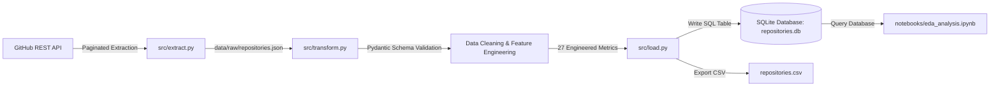

# GitHub Open Source Contributor Tracker & Health Monitor

An end-to-end data pipeline (ETL + EDA) that retrieves public GitHub repository data, validates and transforms it into an analysis-ready dataset across **27 metrics**, loads it into a SQLite database and CSV file, and conducts structured exploratory data analysis to evaluate repository activity, maintenance health, and contribution suitability.

---

## 1. Project Overview & Problem Statement

**Problem Statement:**  
Thousands of open-source repositories exist on GitHub, but evaluating whether a project is actively maintained, welcoming to new contributors, or stagnant can be difficult when looking only at surface-level vanity metrics like star counts. Many popular repositories with thousands of stars are effectively abandoned or backlogged with unresolved issues.

**Solution:**  
This project provides:
1. **Interactive Category Selection:** Allows developers to specify which category of repositories they want to contribute to (e.g., AI/ML, Data Science, Web, DevOps, Systems, Python).
2. **Fast & Resilient Extraction (300 Repositories by Default):** Extracts 300 public repositories across 3 pages in seconds using the GitHub REST API Search endpoint with automatic rate-limit management.
3. **Data Transformation & Pydantic Validation:** Validates incoming records with Pydantic schemas, cleans data with pandas, and calculates **27 metrics** (17 raw extraction metrics + 10 derived indicators).
4. **Structured Loading:** Stores the validated dataset in both an indexed **SQLite database** (`repositories.db`) and a **CSV file** (`repositories.csv`).
5. **Exploratory Data Analysis (EDA):** A fully executed Jupyter Notebook (`eda_analysis.ipynb`) analyzing popularity distributions, activity lifecycles, correlation heatmaps, and identifying top projects to contribute to vs. abandoned repositories.

---

## 2. Dataset Selection & Contribution Categories

Data is extracted live via the GitHub REST API (`https://api.github.com/search/repositories`). When running the pipeline, users can select the domain they wish to contribute to:

| Category Choice | Domain | Search Qualifier | Description |
|---|---|---|---|
| **[1] AI** | Artificial Intelligence & Machine Learning | `topic:machine-learning stars:>10` | ML algorithms, deep learning models, and AI frameworks |
| **[2] Data** | Data Science & Analytics | `topic:data-science stars:>10` | Data analysis, scientific computing, visualization tools |
| **[3] Web** | Web Development | `topic:web stars:>10` | Frontend, backend, full-stack frameworks and APIs |
| **[4] DevOps** | DevOps & Cloud Infrastructure | `topic:devops stars:>10` | CI/CD, Docker, Kubernetes, infrastructure-as-code |
| **[5] Mobile** | Mobile App Development | `topic:android stars:>10` | Mobile apps, SDKs, and multi-platform tools |
| **[6] Systems** | Systems & High Performance | `language:rust stars:>20` | Fast, memory-safe systems programming and CLI utilities |
| **[7] Python** | Python Ecosystem | `language:python stars:>50` | Popular Python libraries, frameworks, and developer utilities |
| **[8] General** | General Popular Open Source | `stars:>100` | Broad spectrum of the most starred open-source projects |

---

## 3. Metrics Processed (27 Metrics)

The pipeline processes **27 metrics**—substantially exceeding the 20-metric requirement:

### Raw Extracted Metrics (17)
1. `stars_count`: Total stargazers (`stargazers_count`)
2. `forks_count`: Total repository forks
3. `open_issues_count`: Total open issues and pull requests
4. `watchers_count`: Subscribers / watchers count
5. `size_kb`: Repository disk size in kilobytes
6. `repo_age_days`: Total repository age in days (from `created_at` to present)
7. `days_since_last_push`: Days since the most recent commit was pushed
8. `days_since_last_update`: Days since repository metadata/issue was updated
9. `has_issues_enabled`: Binary flag (1/0) indicating if issue tracking is enabled
10. `has_projects_enabled`: Binary flag (1/0) indicating if GitHub Projects is active
11. `has_wiki_enabled`: Binary flag (1/0) indicating if GitHub Wiki is enabled
12. `has_pages_enabled`: Binary flag (1/0) indicating if GitHub Pages is hosted
13. `has_discussions_enabled`: Binary flag (1/0) indicating if GitHub Discussions are open
14. `has_license`: Binary flag (1/0) indicating presence of an approved open-source license
15. `is_archived`: Binary flag (1/0) indicating if the repository is read-only / archived
16. `topics_count`: Number of discoverability topics/tags associated with the repo
17. `description_length`: Character length of the repository description

### Derived & Engineered Indicators (10)
18. `fork_to_star_ratio`: `forks / (stars + 1)` — Measures code reuse and developer engagement relative to passive bookmarking.
19. `issues_to_star_ratio`: `open_issues / (stars + 1)` — Measures bug/issue workload relative to the userbase.
20. `issues_to_fork_ratio`: `open_issues / (forks + 1)` — Measures issue resolution demand against the potential developer pool.
21. `push_recency_score` (0–100): Quantifies commit recency (100 if pushed <= 7 days ago, scaling to 0 at 365+ days).
22. `documentation_score` (0–100): Weighted score evaluating license presence, wiki/pages, description richness, and topic tags.
23. `community_health_score` (0–100): Evaluates community infrastructure (issues, discussions, projects, and fork engagement).
24. `maintenance_health_score` (0–100): Composite index scoring overall project health (0 if archived; otherwise combines push recency, documentation, community infrastructure, and issue management).
25. `contributor_friendliness_score` (0–100): Metric designed to identify the best projects for contributors (requires active pushes, non-archived status, available issues to solve between 5 and 200, and solid documentation).
26. `activity_status`: Categorical indicator:
    - **Active** (`days_since_last_push <= 60`)
    - **Moderate** (`61 <= days_since_last_push <= 180`)
    - **Low Activity** (`181 <= days_since_last_push <= 365`)
    - **Inactive** (`days_since_last_push > 365`)
27. `is_potentially_abandoned`: Flag (1/0) identifying repositories that are archived OR have received zero code pushes for >365 days while carrying unaddressed open issues.

---

## 4. Pipeline Architecture



### File Structure
```
Repo-Monitor/
├── data/
│   ├── raw/
│   │   └── repositories.json        # Raw JSON API payload with metadata
│   └── processed/
│       ├── repositories.db          # SQLite database with indexed tables
│       └── repositories.csv         # Exported CSV dataset (1,000 rows, 40 cols)
├── notebooks/
│   └── eda_analysis.ipynb           # Complete Exploratory Data Analysis notebook
├── src/
│   ├── extract.py                   # Category-aware API extraction & rate limiting
│   ├── transform.py                 # Pydantic validation & 27-metric transformation
│   ├── load.py                      # SQLite database & CSV loader
│   └── pipeline.py                  # End-to-end pipeline runner
├── requirements.txt                 # Project dependencies
└── README.md                        # Documentation
```

---

## 5. Installation & Setup

### 1. Create and Activate Virtual Environment
```bash
python3 -m venv .venv
source .venv/bin/activate
```

### 2. Install Dependencies
```bash
pip install -r requirements.txt
```

*(Optional)* If you have a GitHub Personal Access Token, you can export it to increase the Search API rate limit from 10 to 30 requests/min:
```bash
export GITHUB_TOKEN="your_personal_access_token"
```

---

## 6. How to Run

### Run the Full Pipeline Interactively
Run the end-to-end pipeline with category prompt:
```bash
python src/pipeline.py
```

### Run with CLI Arguments
Select a category directly and specify target repository count:
```bash
# Example: Run ETL for Artificial Intelligence (300 repositories)
python src/pipeline.py --category ai --limit 300

# Example: Run ETL for Web Development
python src/pipeline.py --category web --limit 300

# Example: Transform and Load existing raw data without re-fetching
python src/pipeline.py --skip-extract
```

### Run Individual Pipeline Steps
```bash
# 1. Extraction only
python src/extract.py --category ai --limit 300

# 2. Transformation only (runs Pydantic validation & feature engineering)
python src/transform.py

# 3. Load only (writes to SQLite and exports CSV)
python src/load.py
```

### Launch the Streamlit Web Application
Run the interactive dashboard locally:
```bash
streamlit run app.py
```
Open [http://localhost:8501](http://localhost:8501) in your browser.

### Deploying the Web App for Free (Streamlit Community Cloud)
1. Push your latest code to GitHub:
   ```bash
   git add .
   git commit -m "Add Streamlit web app"
   git push origin main
   ```
2. Go to [share.streamlit.io](https://share.streamlit.io) and sign in with your GitHub account.
3. Click **"New app"**, select your repository `Repo-Monitor`, branch `main`, and main file `app.py`.
4. Click **"Deploy"** — you will receive a free public link (e.g., `https://repo-monitor.streamlit.app`) to submit as your live Web App!

### Launch the Exploratory Data Analysis (EDA) Notebook
```bash
jupyter notebook notebooks/eda_analysis.ipynb
# or
jupyter lab notebooks/eda_analysis.ipynb
```

---

## 7. Key Findings from the 300 Repository Analysis

Analyzing 300 machine learning repositories yielded critical insights:
1. **Vanity Stars vs. True Vitality:**  
   High star counts do not ensure active maintenance. Over **27.3%** of analyzed repositories meet the criteria for being **potentially abandoned** (untouched for over a year with unaddressed issues).
2. **Activity Distribution:**  
   - **Active (<=60 days):** ~54.7%
   - **Moderate (61–180 days):** ~6.7%
   - **Low Activity (181–365 days):** ~8.3%
   - **Inactive (>365 days):** ~30.3%
3. **Best Targets for Contributors:**  
   The `contributor_friendliness_score` successfully highlighted prime candidate repositories with active commit recency, clear documentation, and manageable issue pools (e.g., `ultralytics/ultralytics`, `rohitg00/ai-engineering-from-scratch`, `alibaba/MNN`).